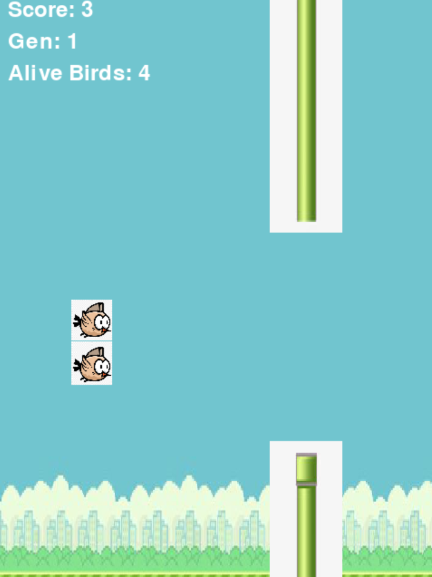
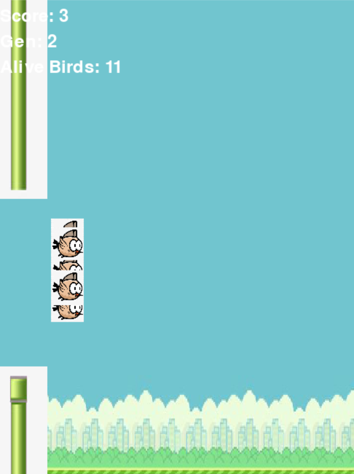

# Autonomous Flappy Bird using Neuroevolution (NEAT)

An implementation of the NeuroEvolution of Augmenting Topologies (NEAT) genetic algorithm to train autonomous agents capable of playing Flappy Bird in real time.

## Evolutionary Progression

### Generation 1: Initial Random Population


### Generation 2: Emerging Swarm Navigation


## Overview

Rather than using manual rule-based heuristics or reinforcement learning methods with slow convergence, this project applies genetic algorithms to evolve neural network topologies. A population of 30 candidate agents is evaluated per generation, with weights and connections optimizing across iterations based on survival time and obstacle clearance.

## Neural Inputs and Architecture

Each agent evaluates three continuous inputs per frame:
1. Bird vertical coordinate (y-position)
2. Distance to the upper pipe boundary
3. Distance to the lower pipe boundary

The controller uses a hyperbolic tangent (`tanh`) activation function to evaluate jumping decisions whenever activation exceeds a 0.5 threshold.

## Tech Stack

- Python 3.12
- Pygame (2D physics simulation and rendering)
- NEAT-Python (neural network evolution and genetic operators)

## Running Locally

1. Install dependencies:
   ```bash
   pip install pygame neat-python
